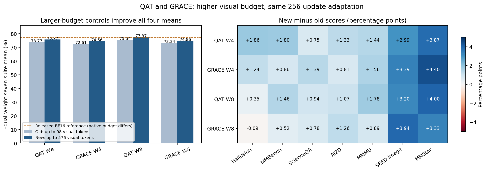

# Larger visual budget QAT and GRACE results

Prepared **2026-10-12**. The four production runs completed October 5–6 Singapore time, followed by full local evaluation October 11–12. This compares the new 589,824-pixel / 4,096-token experiment with the earlier 100,352-pixel / 2,048-token checkpoints in the [evaluation-only baseline](../reproduction_eval_only/experiment_report.md), using **`local_native_greedy256_v1`** throughout.

**The larger-budget setup improves all four seven-suite means by 1.52–2.01 percentage points, but CE-only QAT still outperforms GRACE at both precisions.** QAT W8 reaches **77.37%**, versus **77.40%** for the released BF16 SFT reference under its different native processor. GRACE reaches **74.56% at W4** and **74.86% at W8**, trailing matched QAT by **1.22 and 2.51 pp**. Higher resolution improves absolute scores without resolving the distillation deficit.

All **28/28 new evaluation pairs** have valid completion evidence. The nine historical MMBench result files also pass the current CPU validator; their archived completion markers remain absent. Baseline MMBench scores and means below therefore include validated saved predictions, rather than treating missing bookkeeping as missing accuracy.

## Seven suite comparison

| Method | Old mean % | New mean % | New minus old pp | New minus released BF16 pp |
| --- | ---: | ---: | ---: | ---: |
| QAT W4 | 73.77 | 75.77 | +2.01 | -1.62 |
| GRACE W4 | 72.61 | 74.56 | +1.95 | -2.84 |
| QAT W8 | 75.54 | 77.37 | +1.83 | -0.03 |
| GRACE W8 | 73.34 | 74.86 | +1.52 | -2.54 |

All means weight the seven benchmark metrics equally; they are not pooled accuracy or the LLMC+ aggregate. Scores and deltas are calculated at full precision before rounding. “Old” means the evaluation-only baseline’s latest local protocol, not the older training report’s evaluation recipe.

| Checkpoint | Mean % | Hallusion | MMBench | ScienceQA | AI2D | MMMU | SEED image | MMStar |
| --- | ---: | ---: | ---: | ---: | ---: | ---: | ---: | ---: |
| Vanilla 2B | 66.16 | 62.44 | 76.80 | 83.26 | 76.59 | 39.67 | 76.79 | 47.60 |
| Vanilla 8B teacher | 75.66 | 72.90 | 84.71 | 92.74 | 83.97 | 53.22 | 79.36 | 62.73 |
| Released BF16 SFT | 77.40 | 67.05 | 91.15 | 86.18 | 81.12 | 72.00 | 76.28 | 68.00 |
| Released GRACE W4 | 74.05 | 64.57 | 88.66 | 84.08 | 79.40 | 61.56 | 73.86 | 66.20 |
| Released GRACE W8 | 71.12 | 59.17 | 88.40 | 82.48 | 75.94 | 58.11 | 70.08 | 63.67 |
| Old QAT W4 | 73.77 | 63.86 | 87.63 | 82.88 | 79.37 | 66.33 | 72.44 | 63.87 |
| New QAT W4 | 75.77 | 65.72 | 89.43 | 83.64 | 80.70 | 67.78 | 75.42 | 67.73 |
| Old GRACE W4 | 72.61 | 64.92 | 87.46 | 83.73 | 79.05 | 64.67 | 73.04 | 55.40 |
| New GRACE W4 | 74.56 | 66.16 | 88.32 | 85.12 | 79.86 | 66.22 | 76.44 | 59.80 |
| Old QAT W8 | 75.54 | 64.92 | 89.18 | 84.89 | 80.76 | 70.67 | 72.63 | 65.73 |
| New QAT W8 | 77.37 | 65.28 | 90.64 | 85.83 | 81.83 | 72.44 | 75.83 | 69.73 |
| Old GRACE W8 | 73.34 | 66.43 | 88.40 | 85.71 | 79.44 | 67.44 | 72.77 | 53.20 |
| New GRACE W8 | 74.86 | 66.34 | 88.92 | 86.49 | 80.70 | 68.33 | 76.72 | 56.53 |

### Per task change from the previous controls

| Method | Hallusion | MMBench | ScienceQA | AI2D | MMMU | SEED image | MMStar |
| --- | ---: | ---: | ---: | ---: | ---: | ---: | ---: |
| QAT W4 | +1.86 | +1.80 | +0.75 | +1.33 | +1.44 | +2.99 | +3.87 |
| GRACE W4 | +1.24 | +0.86 | +1.39 | +0.81 | +1.56 | +3.39 | +4.40 |
| QAT W8 | +0.35 | +1.46 | +0.94 | +1.07 | +1.78 | +3.20 | +4.00 |
| GRACE W8 | -0.09 | +0.52 | +0.78 | +1.26 | +0.89 | +3.94 | +3.33 |

**27 of 28 method–task comparisons improve.** The sole decline is GRACE W8 on HallusionBench, **−0.09 pp**, equivalent to one fewer correct answer. The most consistent gains are on SEED image (**+2.99 to +3.94 pp**) and MMStar (**+3.33 to +4.40 pp**). These gains are consistent with additional visual detail helping, but this experiment does not isolate the mechanism: training inputs, evaluation image budgets and the total training length limit all changed.

### GRACE versus matched QAT

| GRACE minus QAT | Hallusion | MMBench | ScienceQA | AI2D | MMMU | SEED image | MMStar | Mean |
| --- | ---: | ---: | ---: | ---: | ---: | ---: | ---: | ---: |
| W4 | +0.44 | -1.12 | +1.49 | -0.84 | -1.56 | +1.01 | -7.93 | -1.22 |
| W8 | +1.06 | -1.72 | +0.66 | -1.13 | -4.11 | +0.89 | -13.20 | -2.51 |

GRACE wins on **HallusionBench, ScienceQA and SEED**, and loses on **MMBench, AI2D, MMMU and MMStar**, at both precisions. Its W4 mean deficit changes from **−1.16 to −1.22 pp**; its W8 deficit widens from **−2.20 to −2.51 pp**. Thus there is no observed aggregate recovery of the distillation benefit at the larger visual budget.

MMStar accounts for most of the average deficit. Excluding it as a diagnostic only, GRACE still trails QAT by **0.10 pp at W4** and **0.73 pp at W8** across the remaining six suites. The seven-suite mean remains the reported outcome; excluding a difficult task would conceal a material regression.

Moving W4 → W8 improves QAT’s mean by **1.59 pp**, but GRACE’s by only **0.30 pp**. GRACE W8 loses **3.27 pp on MMStar** relative to GRACE W4. More weight precision therefore does not solve the observed GRACE behavior.

## Comparison with frozen reference checkpoints

The frozen references in the combined table above are reused from the evaluation-only baseline; they were not rerun in the new experiment. New GRACE exceeds the matching released GRACE mean by **+0.51 pp at W4** and **+3.74 pp at W8**, but still underperforms the stronger matched local QAT controls.

QAT W8 is **0.03 pp below released BF16 on the mean**, with task-specific gains and losses. It improves AI2D (+0.71), MMMU (+0.44) and MMStar (+1.73), while falling on HallusionBench (−1.77), MMBench (−0.52), ScienceQA (−0.35) and SEED (−0.45). This is near-equality of the observed aggregate, not demonstrated statistical or functional equivalence.

Native image budgets differ: released BF16 and vanilla checkpoints use minimum/maximum **65,536 / 16,777,216** pixels; released GRACE W4 uses **784 / 200,704**; released GRACE W8 **784 / 50,176**; new local QAT/GRACE **4,096 / 589,824**. Thus reference comparisons describe checkpoint-plus-processor behavior under the agreed protocol, not an isolated precision effect. Vanilla models also have more unresolved and capped outputs in this protocol.

## MMStar remains the main GRACE weakness

Each category has 250 questions. The following uses the new checkpoints:

| Category | QAT W4 | GRACE W4 | GRACE minus QAT | QAT W8 | GRACE W8 | GRACE minus QAT |
| --- | ---: | ---: | ---: | ---: | ---: | ---: |
| coarse perception | 81.60 | 78.80 | -2.80 | 84.00 | 76.80 | -7.20 |
| fine-grained perception | 62.00 | 59.20 | -2.80 | 63.20 | 56.80 | -6.40 |
| instance reasoning | 80.80 | 73.20 | -7.60 | 81.60 | 69.60 | -12.00 |
| logical reasoning | 63.20 | 54.40 | -8.80 | 66.80 | 51.20 | -15.60 |
| math | 62.80 | 43.60 | -19.20 | 63.60 | 38.40 | -25.20 |
| science & technology | 56.00 | 49.60 | -6.40 | 59.20 | 46.40 | -12.80 |

GRACE remains below QAT in **all six categories** at both bit widths. Math has the largest losses: **−19.20 pp at W4** and **−25.20 pp at W8**. At W8, logical reasoning is also **−15.60 pp** and science/technology **−12.80 pp**. All 1,500 new MMStar responses per checkpoint are bare A/B/C/D choices with zero unresolved answers, inference errors or length stops; the regression is in selected answers, not parser failures or the generation cap.

| Paired MMStar comparison | Only left correct | Only right correct | Net correct |
| --- | ---: | ---: | ---: |
| New GRACE W4 minus new QAT W4 | 74 | 193 | -119 |
| New GRACE W8 minus new QAT W8 | 64 | 262 | -198 |

The larger budget nevertheless raises GRACE’s MMStar score by **4.40 pp at W4** and **3.33 pp at W8** versus its old checkpoint. That is an absolute improvement, while the W8 deficit against QAT grows because QAT improves more.

### HallusionBench gains also appear in grouped consistency

The primary HallusionBench metric remains row accuracy (aAcc) over image and text rows. Auxiliary qAcc and fAcc require all answers in a question group or image-figure group to be correct:

| New checkpoint | aAcc % | qAcc % | fAcc % |
| --- | ---: | ---: | ---: |
| QAT W4 | 65.72 | 32.31 | 34.39 |
| GRACE W4 | 66.16 | 34.07 | 38.73 |
| QAT W8 | 65.28 | 32.53 | 34.10 |
| GRACE W8 | 66.34 | 33.41 | 37.57 |

GRACE improves both grouped metrics relative to QAT at each precision. This supports retaining the per-task evidence even though GRACE loses on the overall mean. Group definitions match the existing local audit; these are auxiliary measurements, not substitutes for the primary seven-suite score.

## Executed configuration and data comparability

Both branches start from the authors’ released **BF16 SFT checkpoint without GDKD/RCKA**. QAT uses CE-only LoRA-QAT; GRACE adds GDKD, RCKA and the adaptive controller. The saved launch recipes confirm:

| Setting | Old controls | New controls |
| --- | ---: | ---: |
| Maximum image area / merged visual ceiling | 100,352 / 98 | 589,824 / 576 |
| Minimum image area | 4,096 | 4,096 |
| Total training sequence cap | 2,048 | 4,096 |
| Training subset / seed / sampling seed | 32,768 / 42 / 2026 | Same |
| GPUs / microbatch / accumulation / effective batch | 2 / 1 / 64 / 128 | Same |
| Optimizer updates / RCKA warmup | 256 / 25 | Same |
| LoRA rank / alpha / dropout | 32 / 64 / 0.05 | Same |
| LoRA / merger / scale LR | 2e-4 / 1e-5 / 2e-4 | Same |
| W4/W8 group size | 128 | Same |
| Training implementation hashes and environment | Pinned | Identical to old controls |

The saved resolved configs differ only in `max_pixels` and `model_max_length`; all training implementation hashes match. The old evaluation-only report’s opening table still lists first-pilot values (batch 64, 512 updates, 50,176 pixels and 1,024 tokens). Those are not the baseline checkpoints compared here; their executed recipes confirm batch 128, 256 updates, 100,352 pixels and 2,048 tokens.

The new and old subsets share **32,767 of 32,768 identities**. One example was added and one removed, **no common conversation text changed**, and **32,512 common records changed token hashes**. There are **32,669 identical positions**, so **99 sequence positions differ**, including the replacement and reordered common examples. Within the new experiment, all four arms use the exact same manifest; across old/new experiments, data order is almost but not completely matched.

The added example (annotation `69378`) has **2,209 total tokens** and is the only new example above 2,048. Its 2,069 nonvisual tokens explain why the longer cap admits it. The removed example (`68543`) had 328 old total tokens. Full-subset token measurements are:

| Token measure | Old mean | New mean | Old median | New median | Old max | New max |
| --- | ---: | ---: | ---: | ---: | ---: | ---: |
| Merged visual | 90.28 | 254.64 | 88.00 | 260.00 | 98 | 576 |
| Nonvisual including formatting | 224.21 | 224.27 | 144.00 | 144.00 | 1777 | 2069 |
| Total input | 314.50 | 478.91 | 234.00 | 421.00 | 1858 | 2209 |

Mean visual count increases **2.82×**, while mean nonvisual count stays almost unchanged. The new visual 95th percentile is **540**; **143/32,768 examples (0.44%)** reach 576. **2,728 (8.33%)** have at least 400 visual tokens. The maximum total sequence is **2,209**, with **zero examples reaching 4,096**. Consequently, the 4,096 limit is headroom rather than typical compute usage. The distribution also explains why production memory is lower than the synthetic 4,096-token stress test.

No token reduction is implemented here. This establishes useful unpruned controls for later LLMC+ integration, but 576 is a ceiling, not a fixed baseline count. Retention fractions and actual retained-count distributions will be more informative than assuming every image starts with 576 tokens.

## Training cost and diagnostics

| Method | Updates | Old elapsed h | New elapsed h | New GPU h | New reserved GiB/GPU | Old reserved GiB/GPU | Elapsed change |
| --- | ---: | ---: | ---: | ---: | ---: | ---: | ---: |
| QAT W4 | 256 | 1.92 | 1.96 | 3.93 | 9.55 | 8.47 | +2.01% |
| GRACE W4 | 256 | 2.39 | 2.51 | 5.02 | 27.13 | 26.07 | +4.96% |
| QAT W8 | 256 | 1.94 | 1.96 | 3.93 | 9.55 | 8.47 | +1.20% |
| GRACE W8 | 256 | 2.38 | 2.50 | 5.00 | 27.13 | 26.07 | +4.98% |

All four runs completed in one successful invocation, without a pause/resume or memory-stop reason. Combined measured launch time is **8.94 elapsed GPU-job hours / 17.87 GPU-hours** across the four sequential two-GPU runs. Per-run launch timing includes loading, training, checkpointing and export; it excludes prior CPU preparation, memory probes, evaluation and the authors’ SFT stage. These are observed wall times on a shared machine, not controlled throughput benchmarks.

GRACE costs **27.8% more elapsed time at W4** and **27.3% more at W8** than QAT, and uses about **2.84×** its peak reserved memory. Relative to the smaller-input controls, new QAT takes **1.2–2.0%** longer and GRACE about **5.0%** longer. The larger visual budget thus improves measured quality at modest additional adaptation cost, while distillation remains substantially more expensive than matched CE-only QAT.

The adaptive beta reaches its upper bound at **update 4 for W4** and **update 5 for W8**, remaining capped for **253/256 (98.83%)** and **252/256 (98.44%)** recorded updates respectively. This supports investigating whether the current KD strength is well matched to the adaptation budget; it does not prove that saturation causes the benchmark regression. Mean logged training CE is **0.606/0.580 for QAT W4/W8** versus **0.954/0.925 for GRACE**. These are training observations, not held-out perplexity, and scalar loss values alone cannot establish gradient conflict. Compare per-term gradients or use a focused loss ablation before making a causal claim.

## Evaluation integrity and limitations

A CPU audit revalidated **91/91 saved pairs**, covering **382,460 prediction rows** across 13 checkpoint evaluations. It checked source identities and labels, coverage, duplicate IDs, native processor settings, decoding/token telemetry, deterministic rescoring, summary arithmetic and completion/provenance hashes where present. All four new exports passed the full-training export check at 256 steps and match their pinned recipe, subset and configured model paths. The audit checked saved checkpoint provenance and export structure; it did not rehash every current checkpoint weight byte.

The new policy and baseline have identical dataset fingerprints, metrics, decoding, attention backend (`flash_attention_2`) and software environment. Their policy differences are the experiment configuration and the evaluation runner hash: the current runner normalizes JSON histogram keys for MMBench validation. Scorer and worker source hashes are unchanged. New saved evaluator hashes match current sources; the baseline’s runner hash is historical. Original predictions, scores, frozen protocols and completion records are unchanged by this report.

New inference has **zero recorded errors**. QAT W8 has **two unresolved, length-capped ScienceQA responses**; all other new outputs resolve without length stops. These same two outputs are counted in both diagnostics. For the old QAT W8, the corresponding totals were six unresolved and five capped. Most observed score changes therefore concern chosen answers, not recovered output formatting. The baseline’s nine MMBench files remain without completion markers, despite passing this audit; the new matrix is formally complete.

MMBench uses **circular accuracy over 1,164 base questions**, requiring all 4,329 supplied rotations to be correct in their groups. It is not the higher row-level accuracy. HallusionBench includes 1,129 image and text rows; ScienceQA all 4,241 test rows; AI2D 3,088 test questions; MMMU 900 validation questions; SEED 14,233 image questions; MMStar 1,500 questions. No paid semantic judging was used.

These are single-training-seed results. Paired answer counts show which predictions changed but do not measure training-seed uncertainty. No confidence interval or equivalence claim is inferred from the near-equal BF16/QAT means. Both training and evaluation image budgets changed, the training cap increased, and a small amount of subset/order changed; therefore higher-resolution inference alone, adaptation to richer inputs and extra text allowance are not isolated effects. The known native `Q(W)+Δ` versus merged/baked `Q(W+Δ)` export issue remains a separate validation question. BF16-stored simulated low-bit exports establish neither packed INT4/INT8 memory savings nor low-bit kernel acceleration.

## Implications for the next experiment

1. **Use new QAT W8 as the strongest measured local quality control**, and QAT W4 for the initial constrained token-reduction study. Retain GRACE as an experimental arm because its task-specific benefits remain relevant, but do not describe distillation as an aggregate improvement.
2. **Keep this completed experiment frozen.** It supplies the larger-budget unpruned controls. Continue the approved token-only LLMC+ reproduction separately, then measure pruning on these checkpoints at matched input budgets and actual retained fractions.
3. **Make the next diagnostic narrow.** To separate resolution from training effects, evaluate old and new checkpoints at a deliberately shared processor budget in a separately named diagnostic. To explain GRACE’s deficit, prioritize MMStar math/logic disagreement sets, native/export correspondence and a matched loss-strength/component check rather than another simultaneous hyperparameter sweep.
4. **Measure latency and token distributions alongside quality.** The new full-subset mean is about 255 visual tokens, so a pruning policy calibrated around a universal 576-token input would misstate actual reduction. Vision-tower and selector overhead still need measurement before any speed claim.

## Supervisor summary

> Increasing the visual ceiling from 98 to 576 tokens and the total training cap from 2,048 to 4,096 improved all four constrained QAT/GRACE checkpoints by 1.52–2.01 percentage points on the same local seven-benchmark protocol. QAT W8 reached 77.37%, close to the released BF16 reference’s 77.40% under different native image budgets. GRACE still trailed matched QAT by 1.22 pp at W4 and 2.51 pp at W8, driven mainly by MMStar deficits, while improving HallusionBench, ScienceQA and SEED. Each QAT run took about 1.96 hours on two A100s; GRACE about 2.50 hours. The new setup is a completed unpruned baseline for token reduction, not evidence yet that pruning or distillation improves the overall trade-off.

## Artifacts

- [New local score matrix](local_development/local_native_greedy256_v1/full/local_scores.md) and [baseline report](../reproduction_eval_only/experiment_report.md).
- [Comparison audit JSON](reports/comparison_audit.json): raw-precision scores, result paths and hashes, completion checks, protocol differences, paired/category diagnostics, cost and subset comparisons.
- [Score CSV](reports/scores_comparison.csv), [PNG figure](reports/score_comparison.png) and [PDF figure](reports/score_comparison.pdf).
- [Full training token audit](reports/training_token_audit.json) and [saved subset comparison](subset_comparison.json).
- Reproduction scripts: [compile comparison](reports/compile_comparison.py), [audit tokens](reports/audit_training_tokens.py), [render report](reports/render_comparison.py). Use `.venv-lmms-eval/bin/python` for compilation, `/home/air/miniconda3/envs/grace/bin/python` for the processor audit, and `/home/air/miniconda3/envs/fm/bin/python` for rendering (Matplotlib is already installed there). These are CPU reporting operations and do not launch inference.

